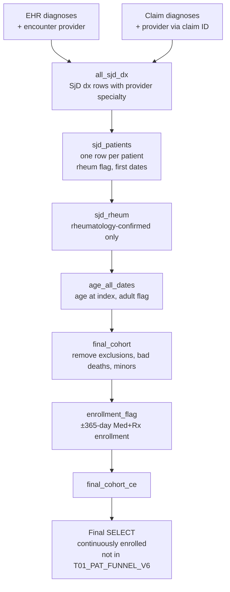

# Sjögren's Disease (SjD) Cohort Build — Rheumatology-Confirmed, Adult, Continuously Enrolled
 
**Data source:** Optum Market Clarity — Sjögren's / Graves' Disease Cohort
**Schema:** `market_clarity_graves_disease_202605_v1_20260622_prod`
**SQL dialect:** Trino / Presto (e.g., AWS Athena) — uses `date_parse`, `last_day_of_month`, `try`, `date_add`
**Output grain:** One row per patient (`ptid`)
 
---
 
## 1. Purpose
 
This query builds the analytic cohort of patients with Sjögren's disease (SjD). It uses Optum Market Clarity, which links EHR records with administrative claims. A patient qualifies when all five of the following are true:
 
1. They have an SjD diagnosis (ICD-10-CM `M35.0x`) recorded by a **rheumatology provider on the same encounter or claim** between 1 Oct 2021 and 31 Mar 2025.
2. They were **18 or older** at that diagnosis.
3. They are **not** on the project exclusion list, and they do not have unreliable death information.
4. They have **continuous medical and pharmacy (Med+Rx) enrollment** for 365 days before and 365 days after the index date.
5. They are **not already present** in `T01_PAT_FUNNEL_V6`.
The **index date** is the patient's earliest rheumatology-associated SjD diagnosis in the study window.
 
---
 
## 2. Data Sources
 
### 2.1 Source tables (Optum Market Clarity)
 
| Table | Data type | Fields used |
|---|---|---|
| `argenx_graves_202605_diag` | EHR diagnoses | `ptid`, `encid`, `diagnosis_cd`, `diag_date` |
| `argenx_graves_202605_enc_prov` | EHR encounter-to-provider link | `encid`, `provid` |
| `argenx_graves_202605_prov` | Provider reference | `provid`, `specialty` |
| `argenx_graves_202605_clm_med_diag` | Medical claim diagnoses | `ptid`, `clmid`, `diag`, `fst_dt` |
| `argenx_graves_202605_clm_rx` | Pharmacy claims | `ptid`, `clmid`, `prov_unique` |
| `argenx_graves_202605_pt` | Patient demographics and mortality | `ptid`, `birth_yr`, `deceased_indicator`, `date_of_death` |
| `argenx_graves_202605_clm_con_enrl` | Continuous enrollment spans | `ptid`, `eligeff`, `eligend`, `coverage_ind` |
 
The schema name indicates a **May 2026 data cut (`202605`), version 1, built 22 June 2026 (`20260622`)**, production environment. *(Inferred from the naming convention — confirm with the data engineering team.)*
 
### 2.2 Upstream dependencies (must exist before running)
 
| Object | Role |
|---|---|
| `excluded_patients_2026` | Project-level patient exclusion list (`ptid`). Its criteria are defined outside this script. |
| `T01_PAT_FUNNEL_V6` | A previously built patient funnel table (`ptid`). Patients in it are removed from the final output. |
 
---
 
## 3. Study Parameters
 
| Parameter | Value |
|---|---|
| Diagnosis code | ICD-10-CM `M35.0` and all subcodes (pattern `M350%`, after removing dots) |
| Diagnosis identification window | 2021-10-01 to 2025-03-31 (inclusive) |
| Qualifying provider specialty | Any specialty containing `RHEUMATOLOG` (e.g., Rheumatology, Rheumatologist, Pediatric Rheumatology) |
| Index date | Earliest rheumatology-associated SjD diagnosis in the window |
| Minimum age | 18 years at index (calendar-year based) |
| Enrollment requirement | Continuous Med+Rx coverage from index − 365 days to index + 365 days |
| Data cutoff for enrollment | 2025-03-31 |
 
The window starts on 1 Oct 2021, which is the effective date of the FY2022 ICD-10-CM code-set update. That update expanded the `M35.0` subcodes, which is the likely reason for this start date. *(Confirm the rationale with the study lead.)*
 
---
 
## 4. Processing Logic
 

 
| Step (CTE) | What it does |
|---|---|
| `ehr_dx` | Pulls EHR SjD diagnoses in the window. It attaches the specialty of each provider on the same encounter (`encid`). |
| `claims_dx` | Pulls medical-claim SjD diagnoses in the window. It attaches provider specialty by matching the claim ID (`clmid`) to the pharmacy claims table and then to the provider table (see Section 8, item 1). |
| `all_sjd_dx` | Stacks EHR and claims diagnosis rows. The `src` column records the origin (`'EHR'` or `'CLAIMS'`). |
| `sjd_patients` | Rolls up to one row per patient. It sets the rheumatology flag and records the first SjD date and the first rheumatology-associated SjD date. |
| `sjd_rheum` | Keeps patients with at least one rheumatology-associated SjD diagnosis. |
| `deceased_patients` | Identifies patients marked deceased with no recorded date of death. |
| `deceased_with_post_death_activity` | Identifies rheumatology-confirmed patients who have diagnosis activity after their death month. |
| `age_all_dates` | Derives birth year, age at index, and the adult flag. |
| `final_cohort` | Applies the exclusion list, the two death-quality exclusions, and the adult requirement. |
| `death_info` | Converts the death month to a date. This date is used to cap enrollment. |
| `enroll_spans` | Pulls Med+Rx enrollment spans. Each span end is capped at the death date and at 2025-03-31. |
| `enrollment_flag` | Checks whether any single span covers the full −365 to +365 day period around the index date. |
| `final_cohort_ce` | Attaches the index date and the enrollment flag. |
| Final `SELECT` | Keeps continuously enrolled patients who are not in `T01_PAT_FUNNEL_V6`. |
 
---
 
## 5. Business Rules
 
**BR-01 — Diagnosis code standardization.** Diagnosis codes are upper-cased and dots are removed before matching. For example, `M35.01` becomes `M3501`. Any code beginning with `M350` qualifies.
 
**BR-02 — Diagnosis date window.** Only diagnoses dated 2021-10-01 through 2025-03-31 are considered. EHR records use `diag_date` and claims use `fst_dt` (first date of service).
 
**BR-03 — Same-visit provider attribution.** A diagnosis counts as rheumatology-associated only when a rheumatology provider is on the **same EHR encounter** (`encid`) or the **same claim** (`clmid`) as the SjD diagnosis. A rheumatology visit on a different day, or on a different encounter on the same day, does not qualify.
 
**BR-04 — Rheumatology specialty match.** A provider counts as rheumatology when their specialty text, after trimming and upper-casing, contains `RHEUMATOLOG`. If an encounter has several providers, it qualifies when any one of them is rheumatology.
 
**BR-05 — Index date.** The index date is the earliest SjD diagnosis date that meets BR-03 and BR-04. The earliest SjD date from any provider (`first_sjd_dx_date`) is also kept for reference, and it may be earlier than the index date.
 
**BR-06 — Birth year handling.** Birth year is read from `birth_yr`. The top-coded values `'1937 and Earlier'` and `'1936 and Earlier'` are set to 1937 and 1936. `'Unknown'` and any non-numeric value become null.
 
**BR-07 — Age and adult requirement.** Age is calculated as the index year minus the birth year. Patients aged 18 or older are kept. Patients with an unknown birth year get a null age and are excluded.
 
**BR-08 — Project exclusion list.** Patients in `excluded_patients_2026` are removed.
 
**BR-09 — Deceased without a death date.** Patients with `deceased_indicator = '1'` but no `date_of_death` are removed, because their follow-up cannot be measured.
 
**BR-10 — Activity after death.** Some rheumatology-confirmed patients are flagged as deceased or have a death date. They are removed if any medical-claim or EHR diagnosis is dated after the **last day of their death month**. The month-end is used because death dates are stored at month level (`YYYYMM`). This check uses the full diagnosis tables with no date window. Patients whose death date cannot be parsed are not removed by this rule.
 
**BR-11 — Enrollment spans.** Only spans with `coverage_ind = 'Med+Rx'` are used, so the patient must have both medical and pharmacy coverage. Each span end is capped at the earliest of three dates: the recorded `eligend`, the death date (the first day of the death month), and the data cutoff of 2025-03-31.
 
**BR-12 — Continuous enrollment.** A patient passes when **one single span** starts on or before index − 365 days and ends on or after index + 365 days. Patients with no Med+Rx span fail.
 
**BR-13 — Prior funnel exclusion.** Patients already in `T01_PAT_FUNNEL_V6` are removed from the final output. *(Confirm the intent. This could produce an incremental "new patients only" list, or it could apply an exclusion from an earlier funnel step.)*
 
---
 
## 6. Patient Attrition (Funnel) Template
 
The step counts are not produced by the script. The table below is a template for reporting them. Each count can be obtained by running `SELECT COUNT(DISTINCT ptid)` against the CTE shown.
 
| # | Step | Source CTE | Patients (N) |
|---|---|---|---|
| 1 | Any SjD diagnosis (`M35.0x`) in window, EHR or claims | `sjd_patients` | |
| 2 | SjD diagnosis with rheumatology provider on same encounter/claim | `sjd_rheum` | |
| 3 | After removing project exclusion list | `final_cohort` (partial) | |
| 4 | After removing deceased without date of death | `final_cohort` (partial) | |
| 5 | After removing activity after death | `final_cohort` (partial) | |
| 6 | Age ≥ 18 at index | `final_cohort` | |
| 7 | Continuous Med+Rx enrollment ±365 days | `final_cohort_ce` with `is_cont_enrolled = 1` | |
| 8 | Not in `T01_PAT_FUNNEL_V6` | Final `SELECT` | |
 
---
 
## 7. Output Specification
 
| Column | Description |
|---|---|
| `ptid` | Optum de-identified patient ID |
| `sjd_flag` | Always 1 (patient has an SjD diagnosis in the window) |
| `rheum_flag` | Always 1 in the output (an SjD diagnosis was made with a rheumatology provider on the same encounter/claim) |
| `first_sjd_dx_date` | Earliest SjD diagnosis date in the window, from any provider |
| `first_rheum_sjd_dx_date` | Earliest rheumatology-associated SjD diagnosis date |
| `final_birth_yr` | Cleaned birth year (top-coded at 1936/1937) |
| `age` | Age at index (index year − birth year) |
| `is_adult` | Always 1 in the output |
| `index_date` | Same value as `first_rheum_sjd_dx_date`; the anchor for all downstream analyses |
| `is_cont_enrolled` | Always 1 in the output |
 
---
 
## 8. Assumptions, Limitations, and Points for Review
 
Items marked **Action** should be confirmed before the cohort counts are shared.
 
**1. The claims provider join uses the pharmacy table — high priority.** `claims_dx` matches medical diagnosis claims (`clm_med_diag`) to **pharmacy** claims (`clm_rx`) on `clmid`. Medical and pharmacy claims are normally separate claim streams, so their IDs are not expected to line up. If they do not, this join has two effects. First, it returns few or no rows, so the cohort becomes almost entirely EHR-driven. Second, any provider that is found is the pharmacy-claim provider (the prescriber or the pharmacy), not the physician who made the diagnosis. Because the join is an `INNER JOIN`, unmatched diagnoses are dropped entirely, not just left without a provider. **Action:** check the claims row count in `all_sjd_dx` (`WHERE src = 'CLAIMS'`). Consider attaching the provider from the medical service-line table (`clm_med_serv`, joined on `ptid` and `clmid`) instead.
 
**2. Provider ID consistency between claims and EHR.** The claims branch joins `rx.prov_unique` to `prov.provid`. Claims provider keys and EHR provider keys may come from different ID systems. **Action:** confirm that the provider table covers both.
 
**3. Effective index window is shorter than the diagnosis window.** Enrollment is capped at 2025-03-31, and the cohort requires 365 days of follow-up. As a result, only patients indexed on or before about 2024-03-31 can pass. Diagnoses identified between April 2024 and March 2025 almost always drop out at the enrollment step. The cutoff is also well before the end of the May 2026 data cut. **Action:** confirm whether 2025-03-31 is still the intended cutoff for this refresh.
 
**4. Prevalent, not incident, cohort.** There is no washout period. A patient diagnosed with SjD before October 2021 can still enter the cohort with a later index date. **Action:** if new-onset patients are required, add a "no SjD diagnosis in the 365 days before index" rule.
 
**5. All EHR diagnosis statuses are included.** The EHR diagnosis pull does not filter on diagnosis status, so "history of" or "possible" diagnoses may qualify. **Action:** confirm whether only active diagnoses should count.
 
**6. Age is approximate.** Age is calculated from calendar years only, so it can be overstated by up to one year. For example, a patient who is 17 on their index date can be counted as 18.
 
**7. Two different death-date conventions.** The post-death activity check uses the **last** day of the death month. The enrollment cap uses the **first** day of the death month. The selection logic also differs slightly: one check uses deceased indicator *or* death date, and the enrollment cap uses deceased indicator *and* death date. The effect is small, but a patient who died during the month their follow-up reaches index + 365 could fail continuous enrollment. **Action:** use one convention throughout.
 
**8. A single span must cover the full period.** BR-12 requires one enrollment record covering index ± 365 days. Two back-to-back spans with no gap (for example, after a plan change) would fail. This is not a concern if `clm_con_enrl` already merges adjacent spans into continuous periods. **Action:** confirm how the table builds its spans.
 
**9. Stale code comment.** The comment above `enroll_spans` says "no death/cutoff capping", but the code does cap at the death date and at the cutoff. The README follows the code. **Action:** update the comment.
 
**10. `NOT IN` and null IDs.** If any exclusion table (`excluded_patients_2026`, `T01_PAT_FUNNEL_V6`, or the death CTEs) contains a null `ptid`, `NOT IN` returns no rows at all. **Action:** add `WHERE ptid IS NOT NULL` inside those subqueries, or switch to `NOT EXISTS`.
 
**11. Inconsistent ID cleaning.** `ptid` is trimmed and upper-cased only in the enrollment joins. All other joins use the raw value. This is harmless if IDs are already clean, but it is inconsistent.
 
**12. Post-death activity is based on diagnoses only.** Pharmacy fills and procedures after death are not checked.
 
**13. Specialty text matching.** Specialty values that abbreviate the word (e.g., `RHEUM`) or misspell it would not match. **Action:** review the distinct `specialty` values in the provider table.
 
---
 
## 9. Suggested Quality Checks
 
1. Fill in the attrition table in Section 6, and check that each step's count is no higher than the step before it.
2. Count qualifying rheumatology diagnoses by `src` (EHR vs. CLAIMS) to confirm both sources contribute (see Section 8, item 1).
3. Plot the distribution of `index_date` by quarter. A sharp drop after Q1 2024 is expected because of Section 8, item 3.
4. Check the age and sex distribution against published SjD epidemiology, which is predominantly female with a typical diagnosis age in middle adulthood.
5. Confirm there is one row per `ptid` in the final output.
6. Spot-check a sample of patients to confirm the rheumatology provider and the SjD diagnosis sit on the same encounter or claim.
---
 
## 10. Glossary
 
| Term | Definition |
|---|---|
| SjD | Sjögren's disease (Sjögren's syndrome); ICD-10-CM `M35.0x` |
| `ptid` | Optum de-identified patient identifier |
| `encid` | EHR encounter identifier |
| `clmid` | Claim identifier |
| Index date | First rheumatology-associated SjD diagnosis date |
| Med+Rx | Enrollment covering both medical and pharmacy benefits |
| Continuous enrollment (CE) | Uninterrupted coverage across the required period around the index date |
| Top-coding | Grouping the oldest birth years into a single value to protect patient privacy |
 
---
 
## 11. Document Control
 
| Field | Value |
|---|---|
| Owner | *TBD* |
| Reviewer | *TBD* |
| Data cut | May 2026 (`202605`), v1, built 2026-06-22 |
| Last updated | *TBD* |
 
